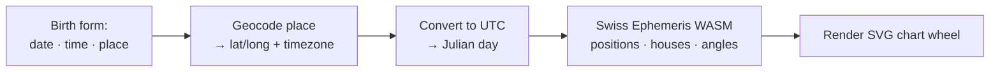

# Aster

A birth chart generator that runs entirely in the browser. Give it a date, a time, and a place, and it draws you a natal chart — no account, and no data leaving your machine unless you want it to.

Lives at [aster.myles.garden](https://aster.myles.garden). Named for the star-shaped flower — _aster_ is Greek for "star".

> **Status:** early. This README describes where the project is headed before most of it exists. Treat it as intent, not a changelog.

## Why

Most birth chart tools send your details off to a server you don't control, then wrap the result in ads. This one does the whole calculation client-side. The astronomy is handled by the [Swiss Ephemeris](https://www.astro.com/swisseph/), compiled to WebAssembly and run in the page — so the site can be served as static files and still produce professional-grade charts.

## Features

- **Client-side.** On the site, positions, house cusps, and angles are computed in-browser via Swiss Ephemeris (WASM). Nothing you enter there is sent anywhere unless you want it to be.
- **Accurate by default.** High-precision ephemeris data, with sensible handling of historical time zones and daylight saving.
- **Static site, small API.** The site ships as static files. A separate [JSON API](#api) runs on a server, for tools that can't run the page.
- **Readable chart wheel.** Rendered as SVG, so it stays crisp at any size and is easy to style or export. A written description of what it shows is read out by screen readers and shown under the wheel.
- **Multiple house systems.** Placidus by default, with others available.
- **Works offline.** Once the site has been opened, a service worker keeps the page and the calculation engine cached, so charts draw without a connection. It can be installed as an app from the browser's menu. The API is never cached.

## How it works



Every step above happens in the browser. The WASM module is loaded once on first use; from then on, generating a chart is instant and offline-capable.

## Tech stack

| Layer     | Choice                      |
| --------- | --------------------------- |
| Framework | Astro                       |
| Language  | TypeScript                  |
| Ephemeris | Swiss Ephemeris (WASM)      |
| Hosting   | Vercel (static + functions) |
| Rendering | SVG                         |

## Getting started

```bash
# 1. Clone
git clone https://github.com/<you>/aster.git
cd aster

# 2. Install
npm install

# 3. Run locally
npm run dev

# 4. Test
npm test

# 5. Build
npm run build
```

### Place data

Place search runs offline against `public/data/places.json`, built from [GeoNames](https://www.geonames.org/) (CC BY 4.0) cities with a population over 15,000. To regenerate it:

1. Download `cities15000.zip`, `admin1CodesASCII.txt` and `countryInfo.txt` from <https://download.geonames.org/export/dump/> into one directory.
2. Unzip `cities15000.zip` there.
3. Run `node scripts/places-build.mjs <that-directory>`.

## Usage

1. Enter a birth date, time, and place. If you don't know the time, tick **I don't know the time** for a noon chart without houses. If the place isn't listed, choose **Not listed? Enter coordinates** and paste its latitude and longitude from any map; the time zone is suggested from the nearest listed place.
2. The place resolves, offline, to coordinates and an IANA time zone; the browser's time zone database supplies the historical offset, Local Mean Time included.
3. The chart is calculated and drawn as an SVG wheel.
4. Adjust the house system if you'd like a different one, and the aspects: major only or minor too, with tight, standard or wide orbs. Minor aspects are drawn as dashed lines.
5. Press **Copy link** to share the chart. The link carries the date, time, GeoNames place ID, house system and any aspect settings in its `#` fragment, which browsers never send to the server, and opening it fills in the form and draws the same chart.
6. Press **Compare with someone else** under the form to add a second person. The chart becomes a bi-wheel, with their planets outside the zodiac, plus the aspects between you and where each person's planets fall in the other's houses.
7. Press **See transits** to set the sky at a moment, now by default, against your chart. Transits count within 2° of exact, and the time is read in your own time zone.
8. Type a name under **Save as** to keep a chart's details in this browser. Saved charts appear at the top of each form, where **Use** fills it in and draws it, and **Forget** removes it. They're stored only in your browser's local storage and never sent anywhere.

## API

A small JSON API calculates the same charts on a server, so tools such as the garden's MCP server can draw one without running the page. It uses Swiss Ephemeris through [`@swisseph/node`](https://github.com/swisseph-js/swisseph), with the same Moshier ephemeris as the browser, so a chart's share link draws what the API returned.

The OpenAPI document is at [`/api/v1/openapi.json`](https://aster.myles.garden/api/v1/openapi.json).

| Endpoint                | Does                                                                                                                                             |
| ----------------------- | ------------------------------------------------------------------------------------------------------------------------------------------------ |
| `POST /api/v1/chart`    | Takes a date, local time, latitude, longitude, time zone, house system and aspect settings; returns positions, houses, aspects and a share link. |
| `GET /api/v1/places?q=` | Searches the GeoNames index for a birthplace's latitude, longitude and time zone.                                                                |

```bash
curl -s https://aster.myles.garden/api/v1/places?q=toronto

curl -s -X POST https://aster.myles.garden/api/v1/chart \
  -H 'Content-Type: application/json' \
  -d '{"date":"1990-05-15","time":"14:30","latitude":43.7064,"longitude":-79.3986,"timeZone":"America/Toronto"}'
```

Leave out `time` when the birth time isn't known: the chart is cast for local noon, without houses or angles. Dates run from roughly 3000 BCE to 3000 CE.

### Privacy

- Birth details are only ever accepted in the request body, never the URL, so they stay out of access logs.
- They're never logged or stored. On an unexpected error the server logs only the error's type, since engine messages quote the birth moment.
- Chart responses are sent with `Cache-Control: no-store`.
- Validation errors name the field and the rule, never the value sent.

### How the code is laid out

- `src/pages/api/v1/` — routes. HTTP only; each hands its request to `src/lib/api/`.
- `src/lib/api/schemas.ts` — strict Zod schemas for every request and response. They validate input, guard output, and generate the OpenAPI document (`src/lib/api/openapi.ts`, via [`zod-openapi`](https://www.npmjs.com/package/zod-openapi)), so the document can't drift from the routes.
- `src/lib/server/` — server-only drivers: the native ephemeris and the bundled place index. The chart service takes the ephemeris as an argument, so the browser and server share every calculation above it.

`astro preview` doesn't run under the Vercel adapter. Use `npm run dev` to try the API locally.

## Roadmap

See [ROADMAP.md](./ROADMAP.md).

## Licence

**AGPL-3.0.**

This project bundles the Swiss Ephemeris, which is dual-licensed under the AGPL or a commercial licence from Astrodienst AG. Because the compiled library is shipped to the browser, the app as a whole is distributed under the AGPL. Code original to this repository is authored by me, but the combined, deployed work carries AGPL terms — including the obligation to make source available.

If you want to build on this in a closed-source or permissively-licensed project, you'll need either a commercial Swiss Ephemeris licence or a different ephemeris engine.

## Acknowledgements

- [Swiss Ephemeris](https://www.astro.com/swisseph/) by Dieter Koch and Alois Treindl, Astrodienst AG — the calculation engine that makes this possible.
- The maintainers of [`@swisseph/browser`](https://github.com/swisseph-js/swisseph) and `@swisseph/node`, the WASM and native bindings that bring it to the web and the API.
- [GeoNames](https://www.geonames.org/) for place data, under CC BY 4.0.

## Code quality

Run `npm run format` to check formatting and `npm run format:fix` to apply it. Oxfmt formats standard source and data files; Prettier handles Astro and Svelte files. Generated place data is excluded.

Run `npm run lint` for oxlint, or `npm run lint:fix` for automatic fixes. Existing style issues are warnings; correctness checks remain errors.

CI runs tests with coverage and JUnit reports, Astro checks, formatting and lint checks on pushes and pull requests to `main`. Use `npm run test:coverage` to generate coverage locally.

## Browser tests

The E2E suite uses [Playwright](https://playwright.dev/docs/test-webserver) against a production build. It serves the built static site with `vite preview` on `127.0.0.1:4399`; keep that port free. The browser tests don't call the API; its routes are covered by unit tests.

1. Run `npx playwright install chromium` once to install the browser.
2. Run `npm run test:e2e` to build and test desktop and 375px mobile Chromium.
3. Run `npx playwright show-report` to inspect results and failure traces.

Use `npm run test:e2e:ui` for interactive debugging. Vitest remains separate under `npm test`.

Coverage includes JavaScript-disabled and delayed-hydration privacy guards, drawing a natal chart with the real WebAssembly engine, and creating and closing a comparison. Place search uses a small local fixture, so tests need no GeoNames download or third-party service. This does not verify the generated production place dataset.

The comparison-update regression for `ISSUES.md` issue 6 verifies that incomplete details preserve both charts and that repairing them allows a consistent retry. CI runs the suite on pushes and pull requests to `main` and retains reports for 14 days.
