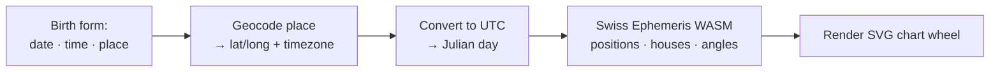

# Aster

A birth chart generator that runs entirely in the browser. Give it a date, a time, and a place, and it draws you a natal chart — no account, no server, no data leaving your machine.

Lives at [aster.myles.garden](https://aster.myles.garden). Named for the star-shaped flower — _aster_ is Greek for "star".

> **Status:** early. This README describes where the project is headed before most of it exists. Treat it as intent, not a changelog.

## Why

Most birth chart tools send your details off to a server you don't control, then wrap the result in ads. This one does the whole calculation client-side. The astronomy is handled by the [Swiss Ephemeris](https://www.astro.com/swisseph/), compiled to WebAssembly and run in the page — so the site can be served as static files and still produce professional-grade charts.

## Features

- **Fully client-side.** Positions, house cusps, and angles are computed in-browser via Swiss Ephemeris (WASM). Nothing is sent anywhere.
- **Accurate by default.** High-precision ephemeris data, with sensible handling of historical time zones and daylight saving.
- **Static deploy.** Ships as a static Astro site — no backend to run or pay for.
- **Readable chart wheel.** Rendered as SVG, so it stays crisp at any size and is easy to style or export.
- **Multiple house systems.** Placidus by default, with others available.

## How it works



Every step above happens in the browser. The WASM module is loaded once on first use; from then on, generating a chart is instant and offline-capable.

## Tech stack

| Layer     | Choice                 |
| --------- | ---------------------- |
| Framework | Astro                  |
| Language  | TypeScript             |
| Ephemeris | Swiss Ephemeris (WASM) |
| Hosting   | Vercel (static)        |
| Rendering | SVG                    |

## Getting started

```bash
# 1. Clone
git clone https://github.com/<you>/aster.git
cd aster

# 2. Install
npm install

# 3. Run locally
npm run dev

# 4. Test
npm test

# 5. Build
npm run build
```

### Place data

Place search runs offline against `public/data/places.json`, built from [GeoNames](https://www.geonames.org/) (CC BY 4.0) cities with a population over 15,000. To regenerate it:

1. Download `cities15000.zip`, `admin1CodesASCII.txt` and `countryInfo.txt` from <https://download.geonames.org/export/dump/> into one directory.
2. Unzip `cities15000.zip` there.
3. Run `node scripts/places-build.mjs <that-directory>`.

## Usage

1. Enter a birth date, time, and place.
2. The place resolves, offline, to coordinates and an IANA time zone; the browser's time zone database supplies the historical offset, Local Mean Time included.
3. The chart is calculated and drawn as an SVG wheel.
4. Adjust the house system if you'd like a different one.

## Roadmap

- [x] Core calculation (planets, houses, angles)
- [x] SVG chart wheel
- [x] Place search + historical time zone lookup
- [x] House system selector
- [x] Aspect lines and orbs
- [ ] Export chart as PNG/SVG
- [ ] Optional high-precision ephemeris files

## Licence

**AGPL-3.0.**

This project bundles the Swiss Ephemeris, which is dual-licensed under the AGPL or a commercial licence from Astrodienst AG. Because the compiled library is shipped to the browser, the app as a whole is distributed under the AGPL. Code original to this repository is authored by me, but the combined, deployed work carries AGPL terms — including the obligation to make source available.

If you want to build on this in a closed-source or permissively-licensed project, you'll need either a commercial Swiss Ephemeris licence or a different ephemeris engine.

## Acknowledgements

- [Swiss Ephemeris](https://www.astro.com/swisseph/) by Dieter Koch and Alois Treindl, Astrodienst AG — the calculation engine that makes this possible.
- The maintainers of [`@swisseph/browser`](https://github.com/swisseph-js/swisseph), the WASM bindings that bring it to the web.
- [GeoNames](https://www.geonames.org/) for place data, under CC BY 4.0.
