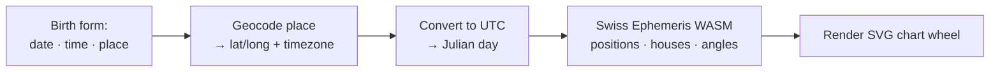

# Aster

A birth chart generator that runs entirely in the browser. Give it a date, a time, and a place, and it draws you a natal chart — no account, and no data leaving your machine unless you want it to.

Lives at [aster.myles.garden](https://aster.myles.garden). Named for the star-shaped flower — _aster_ is Greek for "star".

> **Status:** working. Natal charts, comparisons, composites, transits, progressions, solar returns and lunar returns are all in place; [ROADMAP.md](./ROADMAP.md) lists what's next.

## Why

Most birth chart tools send your details off to a server you don't control, then wrap the result in ads. This one does the whole calculation client-side. The astronomy is handled by the [Swiss Ephemeris](https://www.astro.com/swisseph/), compiled to WebAssembly and run in the page — so the site can be served as static files and still produce professional-grade charts.

## Features

- **Client-side.** On the site, positions, house cusps, and angles are computed in-browser via Swiss Ephemeris (WASM). Nothing you enter there is sent anywhere unless you want it to be.
- **Accurate by default.** Swiss Ephemeris's built-in Moshier ephemeris, which needs no data files and is accurate to well under the arc-minute the chart shows, with sensible handling of historical time zones and daylight saving.
- **Static site, small API.** The site ships as static files. A separate [JSON API](#api) runs on a server, for tools that can't run the page.
- **Readable chart wheel.** Rendered as SVG, so it stays crisp at any size and is easy to style or export. A written description of what it shows is read out by screen readers and shown under the wheel.
- **Multiple house systems.** Placidus by default, with others available.
- **Tropical or sidereal.** The tropical zodiac by default, or the sidereal, with a choice of ayanamsa: Lahiri, Fagan–Bradley, Krishnamurti, Raman, Yukteshwar or True Chitrapaksha.
- **More than one chart.** Compare two people as a bi-wheel or a composite, set transits or secondary progressions against a natal chart, or cast a year's solar return or a month's lunar return.
- **Explained as you go.** A "?" beside each field, setting, table and chart opens a short note on what it means, and the [guide](https://aster.myles.garden/guide/) gathers them all on one page.
- **Works offline.** Once the site has been opened, a service worker keeps the pages, the guide included, and the calculation engine cached, so charts draw without a connection. It can be installed as an app from the browser's menu. The API is never cached.

## How it works



Every step above happens in the browser. The WASM module is loaded once on first use; from then on, generating a chart is instant and offline-capable.

## Tech stack

| Layer     | Choice                      |
| --------- | --------------------------- |
| Framework | Astro                       |
| UI        | Svelte                      |
| Language  | TypeScript                  |
| Ephemeris | Swiss Ephemeris (WASM)      |
| Hosting   | Vercel (static + functions) |
| Rendering | SVG                         |

## Getting started

```bash
# 1. Clone
git clone https://github.com/myles/aster-myles-garden.git
cd aster-myles-garden

# 2. Install
npm install

# 3. Run locally
npm run dev

# 4. Test
npm test

# 5. Build
npm run build
```

### Place data

Place search runs offline against two indexes built from [GeoNames](https://www.geonames.org/) (CC BY 4.0) cities with a population over 15,000:

- `public/data/places-top.json` — the cities of 100,000 or more, about 120 KB over the wire. It loads first, so search starts in about a second on a slow phone connection.
- `public/data/places-all.json` — every city, about 600 KB over the wire. It loads next, then replaces the top index. It's also the one share links and the API look places up in.

Every top city has more people than any city left out, so its results stay first, in the same order, when the whole index takes over. Change either file's row layout under a new name: the service worker serves its cached copy before refreshing it.

To regenerate them:

1. Download `cities15000.zip`, `admin1CodesASCII.txt` and `countryInfo.txt` from <https://download.geonames.org/export/dump/> into one directory.
2. Unzip `cities15000.zip` there.
3. Run `node scripts/places-build.mjs <that-directory>`.

To see how long the indexes take to become searchable, run `npm run places:measure`. It serves them brotli-compressed and loads them as the place field does, in headless Chromium, as is and throttled to a phone's CPU and network. Set `CHROMIUM_PATH` to use a Chromium other than Playwright's own.

## Usage

New to birth charts? Press the **?** beside any field, setting, table or chart for a short explanation, or read the whole [guide](https://aster.myles.garden/guide/).

1. Enter a birth date, time, and place. If you don't know the time, tick **I don't know the time** for a noon chart without houses. If the place isn't listed, choose **Not listed? Enter coordinates** and paste its latitude and longitude from any map; the time zone is suggested from the nearest listed place.
2. The place resolves, offline, to coordinates and an IANA time zone; the browser's time zone database supplies the historical offset, Local Mean Time included.
3. The chart is calculated and drawn as an SVG wheel.
4. Open **Chart settings** under the birth details to adjust the house system if you'd like a different one, the zodiac, tropical or sidereal by one of several ayanamsas, and the aspects: major only or minor too, with tight, standard or wide orbs. Minor aspects are drawn as dashed lines. A sidereal chart says which ayanamsa it uses, and how far behind the tropical zodiac that puts it, and its comparisons, transits, progressions and returns follow the same zodiac. The settings start collapsed, with their current choices summed up on one line. They're remembered in your browser for next time; a shared link's own settings are shown without replacing yours.
5. Under **Download**, save the wheel as SVG or PNG, in light or dark colours whatever the page shows, and the tables as CSV. Press **Copy link** to share the chart. The link carries the date, time, GeoNames place ID, house system, zodiac and any aspect settings in its `#` fragment, which browsers never send to the server, and opening it fills in the form and draws the same chart.
6. Press **Compare with someone else** under the form to add a second person. The chart becomes a bi-wheel, with their planets outside the zodiac, plus the aspects between you and where each person's planets fall in the other's houses. Choose **Composite** to see one chart for the pair instead, made from the midpoints of your positions.
7. Press **See transits** to set the sky at a moment, now by default, against your chart. Transits count within 2° of exact, and the time is read in your own time zone. Each transit shows when it's exact and when it's in orb, searched up to five years either way. A planet that turns retrograde can be exact more than once while in orb, and each time is listed.
8. Press **See progressions** to see your chart moved on a day for each year of life, to today by default or any date after your birth, set against your natal chart as transits are. Progressions count within 1° of exact. Without a birth time there are no houses, and the progressed Moon could be up to 7° out.
9. Press **See solar return** for the chart of the moment the Sun gets back to where it was when you were born. It opens on the return in effect now, cast at your birthplace; change the year, or the place to where you'll be on that birthday. Choose **Against natal chart** to see your natal planets inside a bi-wheel and the return outside, with aspects between them and each return planet's natal house. **Return alone** restores the standalone chart. Share links and downloads follow the selected view. It needs your birth time.
10. Press **See lunar return** for the chart of the moment the Moon gets back to where it was when you were born, which happens about every 27 days. It opens on the return in effect today, cast at your birthplace; choose another date to see the return in effect then, or the place to where you'll be. Choosing the day a return comes on shows that return. **Against natal chart** and **Return alone** work as they do for a solar return. It needs your birth time.
11. Type a name under **Save as** to keep a chart's details in this browser. Saved charts appear at the top of each form, where **Use** fills it in and draws it, and **Forget** removes it. They're stored only in your browser's local storage and never sent anywhere.

## API

A small JSON API calculates the same charts on a server, so tools such as the garden's MCP server can draw one without running the page. It uses Swiss Ephemeris through [`@swisseph/node`](https://github.com/swisseph-js/swisseph), with the same Moshier ephemeris as the browser, so a chart's share link draws what the API returned.

The OpenAPI document is at [`/api/v1/openapi.json`](https://aster.myles.garden/api/v1/openapi.json).

| Endpoint                    | Does                                                                                                                                                     |
| --------------------------- | -------------------------------------------------------------------------------------------------------------------------------------------------------- |
| `POST /api/v1/chart`        | Takes a date, local time, latitude, longitude, time zone, house system, aspect settings and zodiac; returns positions, houses, aspects and a share link. |
| `POST /api/v1/transits`     | Sets the sky at a moment, by default now, against a natal chart, with when each transit comes into orb, is exact and leaves orb.                         |
| `POST /api/v1/progressions` | Progresses a natal chart to a date, by default today, and sets it against the natal chart.                                                               |
| `POST /api/v1/solar-return` | Finds the chart for the moment the Sun returns to its natal position in a year, cast at the birthplace or another place.                                 |
| `POST /api/v1/lunar-return` | Finds the chart for the latest return of the Moon to its natal position by a date, cast at the birthplace or another place.                              |
| `POST /api/v1/synastry`     | Compares two people's charts: the aspects between them, and each person's bodies in the other's houses.                                                  |
| `POST /api/v1/composite`    | Makes one chart from the midpoints of two people's.                                                                                                      |
| `GET /api/v1/places?q=`     | Searches the GeoNames index for a birthplace's latitude, longitude and time zone.                                                                        |

```bash
curl -s https://aster.myles.garden/api/v1/places?q=toronto

curl -s -X POST https://aster.myles.garden/api/v1/chart \
  -H 'Content-Type: application/json' \
  -d '{"date":"1990-05-15","time":"14:30","latitude":43.7064,"longitude":-79.3986,"timeZone":"America/Toronto"}'
```

Leave out `time` when the birth time isn't known: the chart is cast for local noon, without houses or angles. Add an `ayanamsa`, such as `lahiri`, for the sidereal zodiac. Dates run from roughly 3000 BCE to 3000 CE.

Every other chart endpoint takes the chart's request whole, nested as `natal`, or as `first` for a comparison, with its own fields alongside:

```bash
curl -s -X POST https://aster.myles.garden/api/v1/transits \
  -H 'Content-Type: application/json' \
  -d '{"natal":{"date":"1990-05-15","time":"14:30","latitude":43.7064,"longitude":-79.3986,"timeZone":"America/Toronto"},"at":"2026-11-18T15:00Z"}'
```

### Privacy

- Birth details are only ever accepted in the request body, never the URL, so they stay out of access logs.
- They're never logged or stored. On an unexpected error the server logs only the error's type, since engine messages quote the birth moment.
- Chart responses are sent with `Cache-Control: no-store`.
- Validation errors name the field and the rule, never the value sent. A request that's valid but can't be calculated, such as a solar return for a year before the birth, is answered with what to change.

### How the code is laid out

- `src/pages/api/v1/` — routes. HTTP only; each hands its request to `src/lib/api/`.
- `src/lib/api/request.ts` — what every POST route shares: reading and validating the body, and answering errors without logging what was sent. A `ChartInputError` from the chart services is the caller's to fix, so it's a 400; anything else is a 500.
- `src/lib/api/schemas.ts` — strict Zod schemas for every request and response. They validate input, guard output, and generate the OpenAPI document (`src/lib/api/openapi.ts`, via [`zod-openapi`](https://www.npmjs.com/package/zod-openapi)), so the document can't drift from the routes.
- `src/lib/server/` — server-only drivers: the native ephemeris and the bundled place index. The chart service takes the ephemeris as an argument, so the browser and server share every calculation above it.

`astro preview` doesn't run under the Vercel adapter. Use `npm run dev` to try the API locally.

## Interface

The page's look is built from a few building blocks, each defined once, so a change to one shows everywhere it's used.

- `src/styles/global.css` — the colour tokens, light and dark, and the base classes under `@layer components`: `.ui-panel`, `.ui-field`, `.ui-input`, `.ui-button` and its variants, `.ui-table` and the rest. Plain markup can use them directly.
- `src/components/ui/` — Svelte components that wrap those classes with their structure and behaviour: `Button` (`primary`, `secondary`, `action`, `tool` or `quiet`, and `size="small"`), `Field`, `Input`, `Select`, `FormPanel`, `ButtonRow`, `Alert` and `Callout`. `Identifier`, the registry badge, is an Astro component, since it needs no JavaScript.

The page is put together from those blocks:

- `src/components/App.svelte` — the page's state, and how its parts fit together. It holds no markup of its own beyond the layout.
- `src/components/panels/` — the forms in the left column, one per file: `YourChartForm` with `ChartSettingsFields`, `AddToChartMenu`, and a panel for each thing that can be added to your chart (`ComparePanel`, `TransitsPanel`, `ProgressionsPanel`, `SolarReturnPanel`, `LunarReturnPanel`).
- `src/components/views/` — what's drawn beside them, one view per kind of chart, chosen by `ChartResult`. Solar and lunar returns share `ReturnView`, and transits and progressions share `chart/CrossAspectTable`, so a change to one shows in both.
- `src/components/guide/` — the "?" toggles, `HelpToggle` and `HelpPanel`, and the list of guide topics in `topics.ts`.
- `src/components/site/` — the footer, shared by every page.

To see every building block in each of its states, in light and dark, run `npm run dev` and open [`/dev/components`](http://localhost:4321/dev/components). The page lives in `src/dev/` and is added by the `devPages` integration only under `npm run dev`, so a production build never includes it. Add a specimen to `src/dev/ComponentGallery.svelte` when you add a building block.

### The guide

The guide's text is Markdown in `src/content/guide/`, one file per topic, so it can be edited without touching code. Each file opens in place behind its "?" and appears on `/guide`. [Its README](./src/content/guide/README.md) explains the format, and what to change when adding a topic.

The Markdown is rendered when the site is built, so no Markdown parser reaches the browser. The home page passes the rendered topics to `App`, which shares them with every toggle.

### Restyling

To restyle, say, every secondary button, change `.ui-button--secondary` in `global.css`. A component's own classes, such as a margin, still win over these, since they're in the components layer.

## Releases

Releases are made by [release-please](https://github.com/googleapis/release-please-action) from [conventional commits](https://www.conventionalcommits.org/).

1. Pull requests are squash-merged, so each title becomes a commit on `main`. A check fails any title that isn't a conventional commit, such as `feat: add lunar returns` or `fix(ci): patch path-to-regexp`.
2. On each push to `main`, release-please opens or updates a release PR. It lists the changes since the last release and bumps the version: `fix` for a patch, `feat` for a minor version. Before 1.0, a breaking change (`feat!`) bumps the minor version too. `docs`, `chore`, `test`, `refactor`, `ci` and the like don't start a release on their own.
3. Merge the release PR to release. That bumps `package.json`, updates `CHANGELOG.md`, tags the commit as `v` and the version, and publishes a GitHub Release.

The page's footer shows the version from `package.json`, linked to its release, so the deployed site always names the release it was built from. CI doesn't run on release PRs, since they're opened with the workflow's own token and only change the version and the changelog.

## Roadmap

See [ROADMAP.md](./ROADMAP.md).

## Licence

**AGPL-3.0.**

This project bundles the Swiss Ephemeris, which is dual-licensed under the AGPL or a commercial licence from Astrodienst AG. Because the compiled library is shipped to the browser, the app as a whole is distributed under the AGPL. Code original to this repository is authored by me, but the combined, deployed work carries AGPL terms — including the obligation to make source available.

If you want to build on this in a closed-source or permissively-licensed project, you'll need either a commercial Swiss Ephemeris licence or a different ephemeris engine.

## Acknowledgements

- [Swiss Ephemeris](https://www.astro.com/swisseph/) by Dieter Koch and Alois Treindl, Astrodienst AG — the calculation engine that makes this possible.
- The maintainers of [`@swisseph/browser`](https://github.com/swisseph-js/swisseph) and `@swisseph/node`, the WASM and native bindings that bring it to the web and the API.
- [GeoNames](https://www.geonames.org/) for place data, under CC BY 4.0.

## Code quality

Run `npm run format` to check formatting and `npm run format:fix` to apply it. Oxfmt formats standard source and data files; Prettier handles Astro and Svelte files. Generated place data is excluded.

Run `npm run lint` for oxlint, or `npm run lint:fix` for automatic fixes. Lint fails on warnings as well as errors, locally and in CI.

CI runs tests with coverage and JUnit reports, Astro checks, formatting and lint checks on pushes and pull requests to `main`. Use `npm run test:coverage` to generate coverage locally.

## Browser tests

The E2E suite uses [Playwright](https://playwright.dev/docs/test-webserver) against a production build. It serves the built static site with `vite preview` on `127.0.0.1:4399`; keep that port free. The browser tests don't call the API; its routes are covered by unit tests.

1. Run `npx playwright install chromium` once to install the browser.
2. Run `npm run test:e2e` to build and test desktop and 375px mobile Chromium.
3. Run `npx playwright show-report` to inspect results and failure traces.

Use `npm run test:e2e:ui` for interactive debugging. Vitest remains separate under `npm test`.

### Wheel screenshots

The natal wheel, the progressed bi-wheel and the solar return bi-wheel are compared against approved screenshots in `e2e/__screenshots__/`, so a label or glyph that moves fails the build. The wheel's glyphs come from system fonts, so screenshots are only compared on Linux, in the Playwright Docker image CI uses; on other systems `npm run test:e2e` skips them.

1. Start Docker.
2. Run `npm run test:e2e:linux` to run the suite in the image and compare screenshots.
3. After a deliberate change to the wheel, run `npm run test:e2e:linux -- --update-snapshots` to approve new screenshots.
4. Check the new images in `e2e/__screenshots__/` before committing them.

When upgrading `@playwright/test`, change the image tag in `.github/workflows/ci.yml` to match, then approve new screenshots.

Coverage includes JavaScript-disabled and delayed-hydration privacy guards; drawing a natal chart, a composite, progressions, a solar return and a lunar return with the real WebAssembly engine; creating and closing a comparison; drawing a chart offline through the service worker; opening a setting's explanation in place; the guide page, its footer, and the guide offline; and the registry badge and structured data. Place search uses a small local fixture, so tests need no GeoNames download or third-party service. This does not verify the generated production place dataset.

A regression test checks that incomplete comparison details preserve both charts, and that repairing them allows a consistent retry. CI runs the suite on pushes and pull requests to `main` and retains reports for 14 days.
