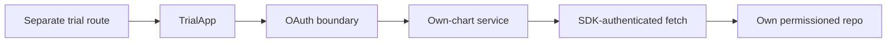

# Personal AT Protocol Spaces trial

This is branch-only work on `save-birth-chart-to-atproto`. The first slice is OAuth sign-in and saving, loading and deleting the signed-in person's own chart in a personal Space created after sign-in. It is not the public-PDS publishing flow described in the original roadmap. Friend discovery and comparison integration are deferred.

## Boundaries

The main `App.svelte`, calculation helpers, saved-chart storage and normal routes are untouched. Trial code and lexicons live here; two thin route files live under `src/pages/trials/`, and tests live under `tests/atproto/`. Keep the experiment on this branch while rebasing from `main`.

Neither trial route is emitted unless the build flag is exactly `true`. Missing or inconsistent settings fail the enabled build. The DID allowlist is enforced after OAuth restoration and by the chart store; mismatched sessions are revoked. This is a client-side trial restriction, not a server-side gate on access to the static page. Data access is enforced by the PDS and Space policies.

All writes target `com.atproto.space.*`, the session's DID, the configured owner-controlled Space, collection `garden.myles.aster.chart`, and singleton record key `self`. There is no public-repo fallback. Birth details are sent only in the explicit save request body. Read requests carry record identifiers, not birth details. Only an explicit `RecordNotFound` response is treated as an empty chart; missing Spaces and authentication errors surface.

## Set up a trial

1. Obtain a Spaces-capable alpha account. The default Space type is `garden.myles.aster.space`; its draft declaration is in `lexicons/garden.myles.aster.space.json`. The provider must be able to resolve that declaration during OAuth consent. Publishing lexicons is still an external setup step.
2. Copy `.env.example` to `.env` locally and set `ASTER_ATPROTO_TRIAL=true`.
3. Set `ASTER_ATPROTO_DID` to the account DID. Leave `ASTER_ATPROTO_SPACE` blank: Aster derives a stable personal Space reference from your DID and the default type. The optional override supports an existing personal Space you own.
4. Set `ASTER_ATPROTO_ORIGIN` to the exact origin you will visit. Use `http://127.0.0.1:4321` locally, or an HTTPS origin for a branch deployment. Localhost is deliberately normalised by requiring the numeric loopback host.
5. Start Astro and visit `/trials/atproto/` at that origin. A deployment must expose `/trials/atproto/client-metadata.json` publicly so the authorization server can discover its OAuth metadata. Restart or rebuild after changing configuration.
6. Sign in through the provider, then press **Create my Aster Space**. Aster requests `com.atproto.space.createSpace` with `spaceType`, key `self` and `com.atproto.personalspace.policy`. It uses the returned `space` URI automatically; no copying is required. After a refresh, the same button reopens the existing Space after checking its personal policy. Existing non-personal Spaces are rejected without changing them. If you signed in before creation support was added, sign out and back in to grant the new creation permission.
7. Enter test birth details, confirm they are yours, and press **Save my chart**. Birth time is omitted unless explicitly selected. Use **Load my saved chart**, **Open my saved chart in Aster**, or **Delete my saved chart** to verify the round trip.

The OAuth SDK stores its session keys and tokens in browser storage. Those credentials are sensitive: do not copy them into `.env`, logs, fixtures or issue reports. The four configuration values are public build settings, not credentials. There are no example passwords, tokens or invitation codes in this package.

OAuth requests `atproto` plus a single `space:` scope, limited to the configured type, own authority, Space key and chart collection. Actions are `read_self`, `create`, `update` and `delete`. The additional `manage=create` permission allows creating that Space. No update/delete management permission is requested, and record saves remain explicit. There is no friend access or repository-wide scope. The Space type must resolve for OAuth consent; publishing or registering a new type requires separate setup outside this branch.

## Record format

The draft lexicon is in `lexicons/garden.myles.aster.chart.json`. It stores `bornAt` as a datetime, `isBirthTimeKnown`, a `location` reference to `community.lexicon.location.geo#main`, IANA `timeZone`, house system and `updatedAt`. Geo coordinates are separate decimal strings, with an optional location name. Birth date remains required input. Unknown or deliberately withheld birth times use noon on that date in the birthplace's time zone; `isBirthTimeKnown` is false, and loading the record restores an unknown time so houses and angles remain absent. The actual withheld time is never used to compute the persisted datetime.

Optional `aiPreferences` references `community.lexicon.preference.ai#preferenceSet`. The four supported preferences are training, embedding, inference and synthetic content; each declares `allow` and its own `updatedAt`. For this chart, `inference` covers sending chart data to an AI model, including a hosted LLM, to generate text such as a horoscope. `syntheticContent` can separately describe permission for the resulting generated content. Aster treats omitted `aiPreferences` and any omitted preference, including `inference`, as denied: chart data must not be sent to an AI model without an explicit `allow: true`. This embeds chart-specific metadata, not a standalone account-wide AI record, and does not enforce what other applications do. The current form preserves preferences from loaded records but does not yet provide controls for editing them.

This replaces the unpublished draft's `birthDate`, `birthTime`, `coordinates` and `placeName` fields. Old draft records are rejected rather than silently reinterpreted; nothing has been published or migrated. The main Aster calculation model is unchanged.

The adapter validates records before writing and after reading. In particular it checks calendar validity and time ranges locally, since the main application's input parsers currently check only string shape. Loaded listed places become coordinate places; their calculation inputs are preserved without depending on a particular GeoNames index. The record is replaced at the same key when saving again. Deleting removes that record, not the Space or any other data.

Space access is not end-to-end encryption. Your PDS and authorized Space participants or applications can read its data. Changing access later does not retract copies others already made. Use test data during this alpha. The creation flow uses a personal policy and verifies that policy before reopening an existing Space. It never silently converts an existing Space or adds members.

## Verification and maintenance

Run `npm test -- tests/atproto` for the trial tests. Run `npm run test:e2e:atproto` for the enabled production build with a synthetic DID and Space; it checks the real OAuth SDK loads but never signs in. The default `npm run test:e2e` verifies both trial routes return 404. CI runs both configurations. `npm run check`, `npm run format` and the existing E2E suite still apply. Test both a disabled default build and an enabled build before rebasing.

The browser OAuth SDK and its alpha dependency chain are pinned to `0.0.0-spaces-alpha-20261112204144`. Pinning avoids prerelease ranges selecting incompatible stable packages, including packages with unpublished `workspace:` references. The incomplete generated `@atproto/api` package is not used. `store.ts` is the only place with raw record endpoints, so protocol changes stay local.

The SDK currently brings npm audit's high-severity Zod advisory, “Zod can exhaust memory while validating oversized constrained collections” (`zod <4.6.6`), through its Zod 3 dependency chain. A forced major-version override would risk breaking OAuth validation and has not been applied. Treat this as an unresolved alpha dependency risk; keep the trial disabled outside the personal branch.

A live OAuth/PDS round trip still requires the actual trial DID and provider, plus provider-side resolution of the Space type declaration. Unit tests use fake sessions; they do not prove provider interoperability or the Space's privacy policy.

References: [Spaces alpha](https://atproto.com/blog/atproto-spaces-alpha), [current proposal](https://github.com/bluesky-social/proposals/tree/main/0016-permissioned-data), [reference record schemas](https://github.com/bluesky-social/atproto/tree/permissioned-data/lexicons/com/atproto/space).

## Pre-publication review

The Space's consent label is `title: "myles.garden"`, using the field supported by the pinned November alpha SDK. The old `name` field has been removed. The record remains `garden.myles.aster.chart`, with a singleton `self` key and calculation inputs rather than computed results.

Tests validate both declarations with `@atproto/lex-document` and validate emitted records against the chart schema compiled by the same SDK. Runtime validation now counts the place-name bound as UTF-8 bytes and checks `updatedAt` with the protocol's datetime validator. Regression tests reproduce both mismatches before their fixes.

The Space type is `garden.myles.aster.space`, dedicated to Aster, with the display title `aster.myles.garden`. It declares only `garden.myles.aster.chart`. Other garden apps should use separate Space types so their read grants do not include birth details. Renaming a Space type does not migrate data already saved under it. Clear any `ASTER_ATPROTO_SPACE` override that still points at the old type and sign in again to grant access to the new type. Both declarations still require publication and DNS resolution before live OAuth can succeed.
