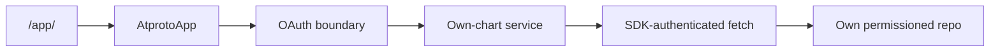

# AT Protocol Spaces

Aster can save the signed-in person's own chart to a personal Space on their AT Protocol account. It lives at `/app/`, which nothing links to yet and which asks search engines not to index it. Friend discovery and comparison are future work.

## Boundaries

The page is `src/pages/app/index.astro`, rendering `src/components/atproto/AtprotoApp.svelte`. The OAuth boundary, record store, record format and lexicons live here. The OAuth SDK is imported dynamically, so it stays out of the main application and server rendering.

`/app/client-metadata.json` is rendered per request from the request's origin, so production and preview deployments each publish matching OAuth metadata with no configuration. Only HTTPS origins can publish metadata. For local development, open `http://127.0.0.1:4321/app/`; Aster then uses a loopback client, which requires the numeric host, and refuses `localhost`.

Any account can sign in with its handle. The Space is always `at:space/<did>/garden.myles.aster.space/self` for the signed-in DID, so a session can only reach its own Space. Data access is enforced by the PDS and Space policies.

All writes target `com.atproto.space.*`, the session's DID, that personal Space, collection `garden.myles.aster.chart`, and singleton record key `self`. There is no public-repo fallback. Birth details are sent only in the explicit save request body. Read requests carry record identifiers, not birth details. Only an explicit `RecordNotFound` response is treated as an empty chart; missing Spaces and authentication errors surface.

## Using it

1. Use a Spaces-capable alpha account. The Space type `garden.myles.aster.space` is declared in `lexicons/garden/myles/aster/space.json`; the provider must be able to resolve that declaration during OAuth consent, and publishing lexicons is an external setup step.
2. Open `/app/`, enter your handle and sign in through your provider.
3. Aster looks up your personal Space with `com.atproto.space.getSpace`, checks its personal policy, and loads your chart. If one is saved, it's drawn straight away; use **Edit my details** or **Delete my saved chart** to change it. Existing non-personal Spaces are rejected without changing them. If the Space or chart can't be read, Aster shows the error and **Try again**, never a blank form that could overwrite it.
4. With no saved chart, enter birth details, confirm they are yours, and press **Save my chart**. Birth time is omitted unless explicitly selected. If you have no Space yet, the first save creates it with `com.atproto.space.createSpace`, using `spaceType`, key `self` and `com.atproto.personalspace.policy`, before writing the record. If you signed in before creation support was added, sign out and back in to grant the creation permission.
5. Press **Add someone** to save another person's chart. It's stored in your own Space as another `garden.myles.aster.chart` record, with their `name` and a TID key chosen by your PDS; `self` stays your own. Nothing is written to their account. Confirm you have their permission first; their birth time is omitted unless explicitly selected. Your chart is then shown as a bi-wheel with theirs, and **Compare with** switches between the people you've saved. **Edit** and **Remove** change only that person's record.

The OAuth SDK stores its session keys and tokens in browser storage. Those credentials are sensitive: do not copy them into logs, fixtures or issue reports. There are no example passwords, tokens or invitation codes in this package.

OAuth requests `atproto` plus a single `space:` scope, limited to Aster's Space type, own authority, Space key and chart collection. Actions are `read_self`, `create`, `update` and `delete`. The additional `manage=create` permission allows creating that Space. No update/delete management permission is requested, and record saves remain explicit. There is no friend access or repository-wide scope.

## Record format

The draft lexicon is in `lexicons/garden/myles/aster/chart.json`. It stores `bornAt` as a datetime, `isBirthTimeKnown`, a `location` reference to `community.lexicon.location.geo#main`, IANA `timeZone`, house system and `updatedAt`. Geo coordinates are separate decimal strings, with an optional location name. Birth date remains required input. Unknown or deliberately withheld birth times use noon on that date in the birthplace's time zone; `isBirthTimeKnown` is false, and loading the record restores an unknown time so houses and angles remain absent. The actual withheld time is never used to compute the persisted datetime.

Optional `aiPreferences` references `community.lexicon.preference.ai#preferenceSet`. The four supported preferences are training, embedding, inference and synthetic content; each declares `allow` and its own `updatedAt`. For this chart, `inference` covers sending chart data to an AI model, including a hosted LLM, to generate text such as a horoscope. `syntheticContent` can separately describe permission for the resulting generated content. Aster treats omitted `aiPreferences` and any omitted preference, including `inference`, as denied: chart data must not be sent to an AI model without an explicit `allow: true`. This embeds chart-specific metadata, not a standalone account-wide AI record, and does not enforce what other applications do. The current form preserves preferences from loaded records but does not yet provide controls for editing them.

This replaces the unpublished draft's `birthDate`, `birthTime`, `coordinates` and `placeName` fields. Old draft records are rejected rather than silently reinterpreted; nothing has been published or migrated. The main Aster calculation model is unchanged.

The adapter validates records before writing and after reading. In particular it checks calendar validity and time ranges locally, since the main application's input parsers currently check only string shape. Loaded listed places become coordinate places; their calculation inputs are preserved without depending on a particular GeoNames index. The record is replaced at the same key when saving again. Deleting removes that record, not the Space or any other data.

Space access is not end-to-end encryption. Your PDS and authorized Space participants or applications can read its data. Changing access later does not retract copies others already made. Use test data during this alpha. The creation flow uses a personal policy and verifies that policy before reopening an existing Space. It never silently converts an existing Space or adds members.

## Lexicons

Every lexicon Aster uses is installed with the `lex` CLI from `@atproto/lex` and tracked in the root `lexicons.json` manifest, which pins each one by CID. `lex install` writes them to the root `lexicons/` directory; commit both.

- Aster's own drafts are authored here, under `lexicons/garden/myles/aster/`: the chart, its Space type, and `releaseNotes`, the content of each changelog document. Since they aren't published yet, the manifest's `directory` resolver points at this folder, and `lex install` symlinks them into the root `lexicons/`. Edit them here, never through the symlinks, and keep hand-written files out of the root `lexicons/`: `lex install` deletes JSON files there that the manifest doesn't list.
- `community.lexicon.location.geo`, `community.lexicon.preference.ai`, `site.standard.document`, `site.standard.publication` and `app.bsky.feed.post`, with their dependencies, are fetched from the network. They're MIT-licensed by Lexicon Community; the licence is kept at `lexicons/community/LICENSE`.
- The `com.atproto.space.*` endpoints aren't published as resolvable lexicons during the alpha, so they can't be installed yet.

`npm run lexicons:build` runs `lex build`, generating TypeScript schemas for every installed lexicon in `src/lexicons/`. Code imports a lexicon's namespace, such as `import * as siteDocument from "@/lexicons/site/standard/document"`, for its types, its `$nsid` and its validators. The `com.atproto.repo.*` methods come with `@atproto/lex-client` itself. The generated files are committed, so every tool sees them without a build step; they are never edited by hand, and formatting, linting and `astro check` skip them.

After changing the manifest or Aster's drafts:

1. Run `npm run lexicons:install`.
2. Run `npm run lexicons:build`.
3. Commit `lexicons.json`, `lexicons/` and `src/lexicons/` together.

`npm run lexicons:check` verifies the installed files against their pinned CIDs. CI runs it, then rebuilds the schemas and fails if anything in `src/lexicons/` changed.

## Using the schemas

- `record.ts` checks chart records with the generated `garden.myles.aster.chart` schema, then the few things the lexicon can't say: a time zone the browser knows, a house system Aster draws, and a 200-byte bound on the place name.
- The changelog checks each standard.site document and its `releaseNotes` content before writing it, and again when reading it back; a document that fails is skipped with a warning. Items' links must also be `https://`, since the lexicon allows any URI scheme and they're rendered as links.
- `xrpc.ts` gives `@atproto/lex-client` `Client`s for Aster's account: a public one for reading, and one logged in with an app password through `@atproto/lex-password-session`. Documents are written with `createRecord` and `putRecord`, because their content is Aster's own type and the typed `create` and `put` only accept the lexicon's open union.
- `store.ts` still calls the Space endpoints itself, since they have no installable lexicons yet.

## Verification and maintenance

Run `npm test -- tests/lib/atproto tests/components/atproto` for the unit tests. `e2e/atproto.spec.ts` checks the production build serves `/app/`, loads the real OAuth SDK without errors and keeps sign-in disabled without JavaScript; it never signs in.

Every `@atproto/*` package is pinned exactly to the same Spaces alpha, `0.0.0-spaces-alpha-20261117141222`: only the alpha understands `space` definitions, and this alpha pins its own dependencies exactly, so no overrides are needed. Earlier alphas used prerelease ranges that resolved to broken packages; pin any future alpha exactly too. The incomplete generated `@atproto/api` package is not used. `store.ts` is the only place with raw Space endpoints, so protocol changes stay local.

The SDK depends on Zod 3, which has a high-severity advisory (“Zod can exhaust memory while validating oversized constrained collections”, `zod <4.6.6`). `package.json` overrides it to Zod 4. The SDK's schemas still parse and reject as expected in the unit and browser tests, but this is not an upstream-supported combination: re-check sign-in end to end after any SDK or Zod update, and drop the override once the SDK moves to Zod 4.

A live OAuth/PDS round trip still requires a real account and provider, plus provider-side resolution of the Space type declaration. Unit tests use fake sessions; they do not prove provider interoperability or the Space's privacy policy.

References: [Spaces alpha](https://atproto.com/blog/atproto-spaces-alpha), [current proposal](https://github.com/bluesky-social/proposals/tree/main/0016-permissioned-data), [reference record schemas](https://github.com/bluesky-social/atproto/tree/permissioned-data/lexicons/com/atproto/space).

## Pre-publication review

The Space's consent label is `title: "aster.myles.garden"`, using the field supported by the pinned November alpha SDK. The old `name` field has been removed. The record remains `garden.myles.aster.chart`, with a singleton `self` key and calculation inputs rather than computed results.

Tests validate both declarations with `@atproto/lex-document` and validate emitted records against the chart schema compiled by the same SDK. Runtime validation now counts the place-name bound as UTF-8 bytes and checks `updatedAt` with the protocol's datetime validator. Regression tests reproduce both mismatches before their fixes.

The Space type is `garden.myles.aster.space`, dedicated to Aster, with the display title `aster.myles.garden`. It declares only `garden.myles.aster.chart`. Other garden apps should use separate Space types so their read grants do not include birth details. Renaming a Space type does not migrate data already saved under it. Sign in again after a rename to grant access to the new type. Both declarations still require publication and DNS resolution before live OAuth can succeed.
